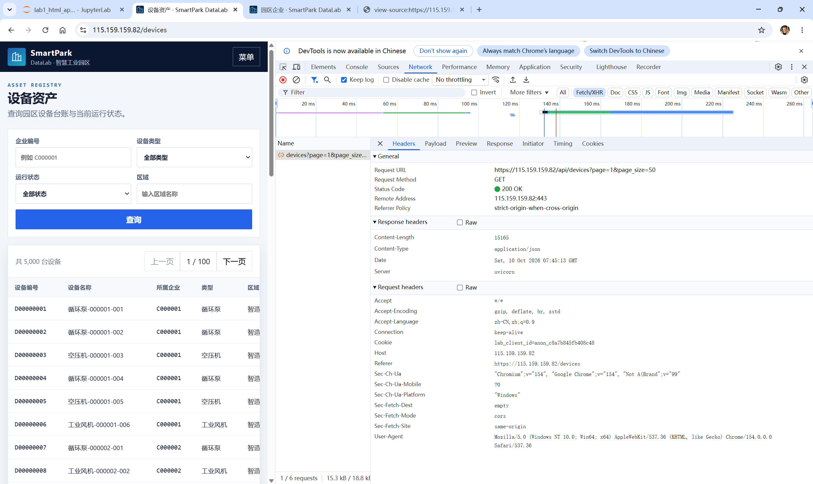
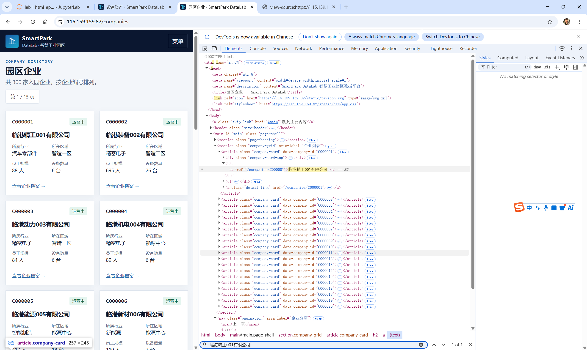
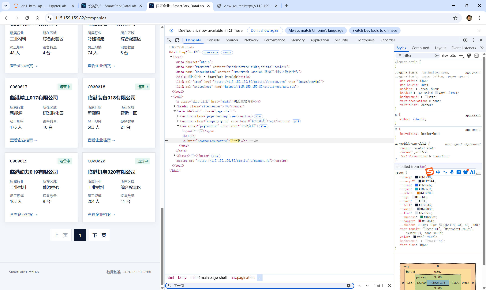
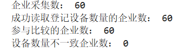

# Lab 1 实验报告

## 学生信息
- **姓名：** 待填写
- **学号：** 待填写
- **班级：** 待填写
- **GitHub 用户名：** 待填写
- **仓库地址：** 待填写

# 任务 1：判断数据加载方式

## 1.1 Device：判断动态加载并找到 API

- 页面：`/devices`
- 数据加载方式：动态加载（以实际“查看网页源代码”和 Network 检查结果为准）
- 判断依据：在页面源代码中搜索可见设备名称；若初始 HTML 中找不到，而 Network 的 Fetch/XHR 中存在返回设备列表的请求，则说明设备数据通过 API 动态加载。

### API 信息
- Request URL：运行实验时从 Network → Headers 复制填写
- Request Method：按 Network 实际观察填写
- Query 参数：按 Network 实际观察填写

### 【截图 1】Device API 发现证据


## 1.2 Company：判断静态加载
- 页面：`/companies`
- 数据加载方式：静态加载（需以网页源代码搜索结果确认）
- 判断依据：在“查看网页源代码”中使用 Ctrl+F 搜索页面实际显示的企业名称；能找到对应企业记录，则说明该数据随初始 HTML 返回。

### 【截图 2】Company 静态加载证据


# 任务 2：Device API 分页采集

## 2.1 API 分页结构
| 含义 | JSON 字段 |
|---|---|
| 当前页 | 按实际 JSON 填写 |
| 每页条数 | 按实际 JSON 填写 |
| 设备总数 | 按实际 JSON 填写 |
| 设备列表 | 按实际 JSON 填写 |

## 2.2 关键代码
```python
total = data[TOTAL_KEY]
page_size = data[PAGE_SIZE_KEY]
total_pages = (total + page_size - 1) // page_size

devices = []
for page in range(1, total_pages + 1):
    r = session.get(API_URL,
                    params={PAGE_PARAM: page, PAGE_SIZE_PARAM: page_size},
                    timeout=20, verify=False)
    r.raise_for_status()
    page_data = r.json()
    devices.extend(page_data[ITEMS_KEY])
```

## 2.3 采集结果
- 每页条数：以实际 API 返回值填写
- 设备总数：目标 5000 条，以实际运行结果填写
- 程序计算得到的总页数：由 `total` 与 `page_size` 计算
- 最终采集设备数：以实际运行结果填写
- 唯一 `device_id` 数：以实际运行结果填写

**为什么总页数应由 API 返回值计算？**  
因为数据总量和每页条数可能变化。根据接口返回的 `total` 和 `page_size` 计算总页数，能适应数据规模变化，避免漏采或请求不存在的页面。

# 任务 3：Company HTML 解析

## 3.1 企业记录 Selector
- 企业记录 selector：按实际 DOM 填写
- 第 1 页企业记录数：目标 20 条，以实际运行结果填写

**说明：** 优先选择语义明确、稳定的 `class`、`id` 或 `data-*` 属性，避免过长且依赖页面位置的 `nth-child(...)` 路径。最终 selector 应通过 `soup.select()` 验证。

## 3.2 关键代码
```python
cards = soup.select(COMPANY_CARD_SELECTOR)
card = cards[0]
company_id = card.get(COMPANY_ID_ATTRIBUTE)
name = card.select_one(COMPANY_NAME_SELECTOR).get_text(" ", strip=True)
status_node = card.select_one(COMPANY_STATUS_SELECTOR)
status = status_node.get_text(" ", strip=True) if status_node else ""
```

行业、区域、设备数量：从企业记录中的 `dl > div` 逐项读取 `dt` 与 `dd`，转换成字典后按实际标签取值；设备数量转换为整数。

## 3.3 字段来源说明
1. `company_id`
   - 来自：HTML 属性（以实际 DOM 为准）
   - 使用的方法：`card.get("实际 data-* 属性名")`
2. `name`
   - 来自：HTML 文本
   - 使用的方法：`card.select_one("实际名称 selector").get_text(" ", strip=True)`

# 任务 4：Company “下一页”分页

## 4.1 下一页元素
- “下一页” selector：按实际 DOM 填写
- 第 1 页 `href` 示例：运行时从被选中的链接读取

### 【截图 3】Company “下一页”元素


## 4.2 关键代码
```python
next_link = soup.select_one(NEXT_SELECTOR)
next_href = next_link.get("href")
next_url = urljoin(current_url, next_href)
```

程序请求当前页并解析企业记录，再定位“下一页”链接、读取 `href`，用 `urljoin()` 生成下一页完整 URL，然后请求并解析；循环三次即可采集前三页。

## 4.3 三页采集结果
| 页码 | 企业数 |
|---|---:|
| 1 | 以实际运行结果填写 |
| 2 | 以实际运行结果填写 |
| 3 | 以实际运行结果填写 |
| **合计** | 目标 60 |

- 唯一 `company_id` 数：以实际运行结果填写

# 任务 5：结果验证

## 5.1 最终结果
| 检查项 | 结果 |
|---|---:|
| Company 总数 | 以实际运行结果填写 |
| 唯一 `company_id` | 以实际运行结果填写 |
| Device 总数 | 以实际运行结果填写 |
| 唯一 `device_id` | 以实际运行结果填写 |
| Company–Device 不一致企业数 | 以实际运行结果填写 |

### 【截图 4】最终验证结果


## 5.2 一致性检查关键代码
```python
device_counts = Counter(x["company_id"] for x in devices)
mismatch_count = 0
for company in companies:
    cid = company["company_id"]
    expected = company["device_count"]
    actual = device_counts.get(cid, 0)
    if expected is not None and expected != actual:
        mismatch_count += 1
```

**为什么 `status_code == 200` 仍然不能说明数据采集正确？**  
HTTP 200 只表示服务器成功处理了请求，不保证返回的数据结构、记录数量、字段内容和分页结果符合预期。还需要检查 JSON 结构、总数、ID 唯一性以及 Company–Device 数量一致性。

# 任务 6：保存采集结果
- `companies.json`：完成运行后确认是否生成
- `devices.json`：完成运行后确认是否生成

# 实验结论
本实验通过查看网页源代码和 Network 判断数据加载方式。Device 页面采用 API 返回 JSON，可根据接口中的总条数和每页条数计算总页数并逐页采集；Company 页面采用 requests 获取 HTML，再用 BeautifulSoup 和 CSS Selector 提取企业字段，并根据“下一页”链接连续访问前三页。最后通过记录数量、ID 唯一性及 Company–Device 设备数对照检查结果，并将数据保存为 JSON 文件。
