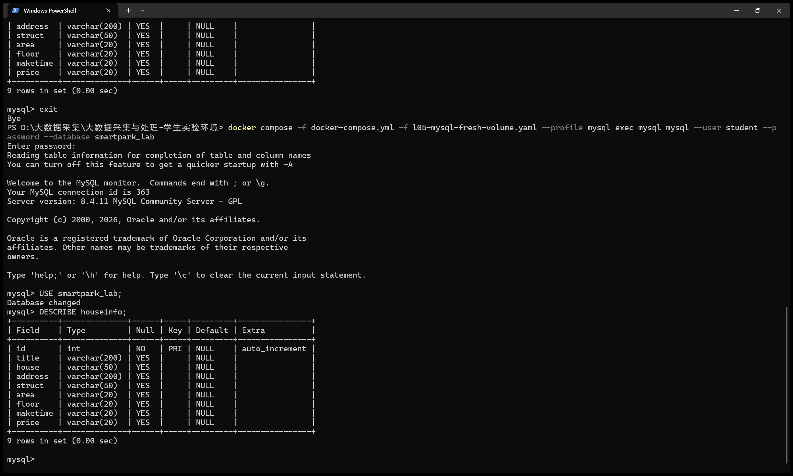
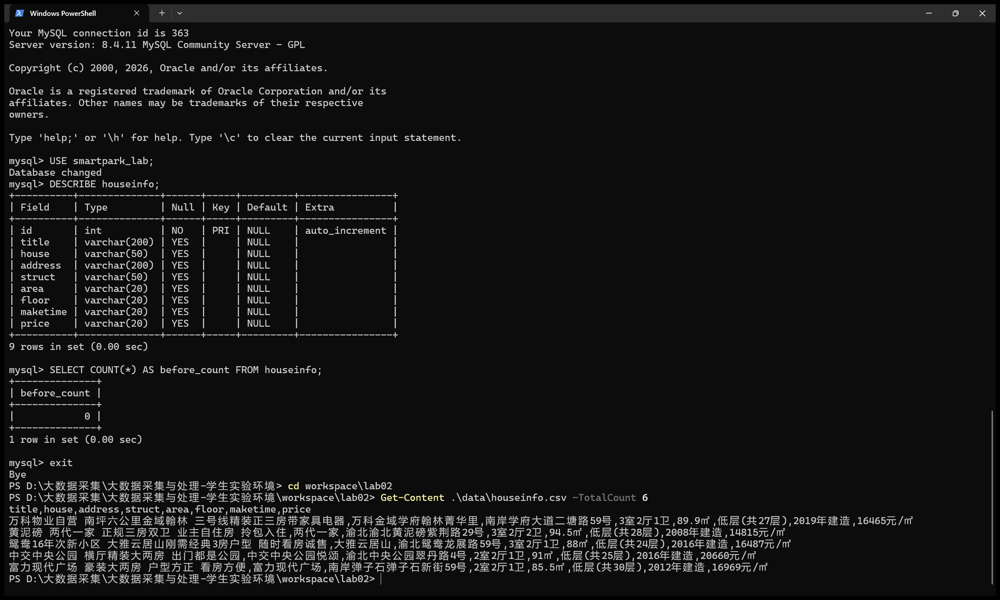
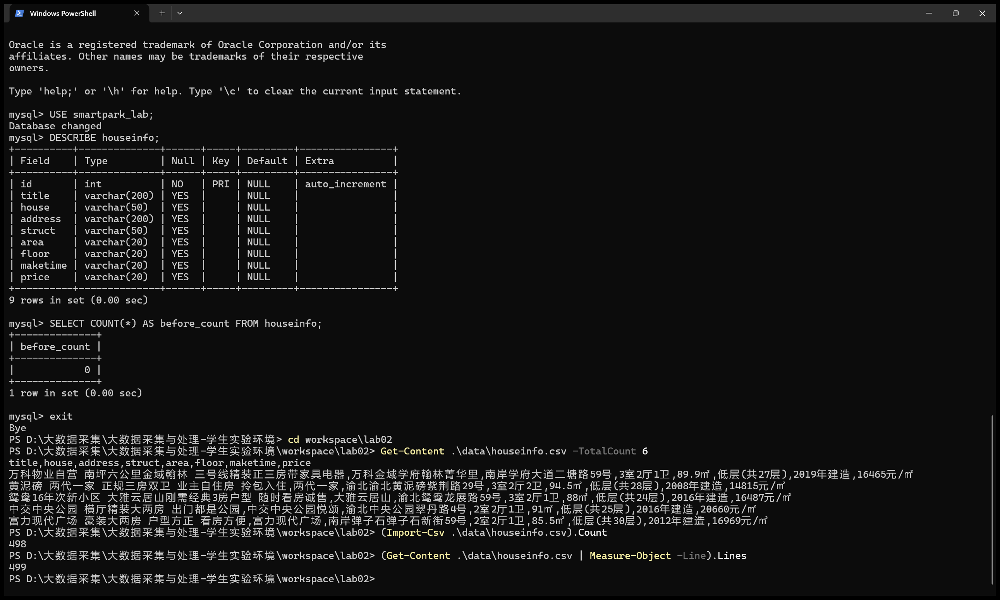
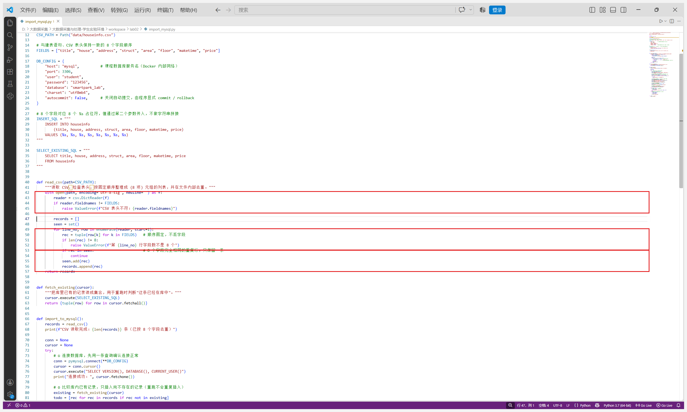
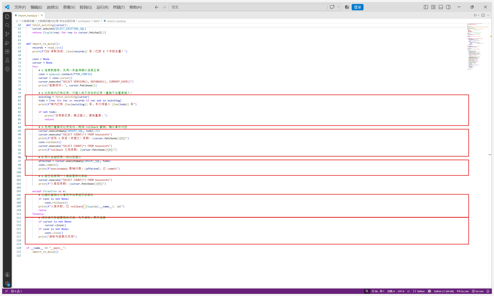
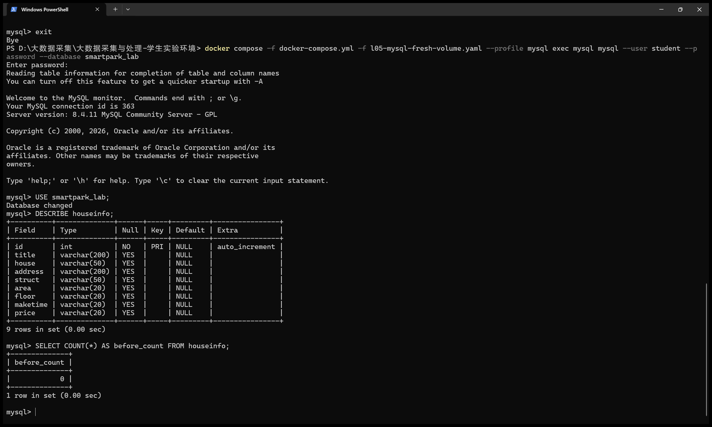
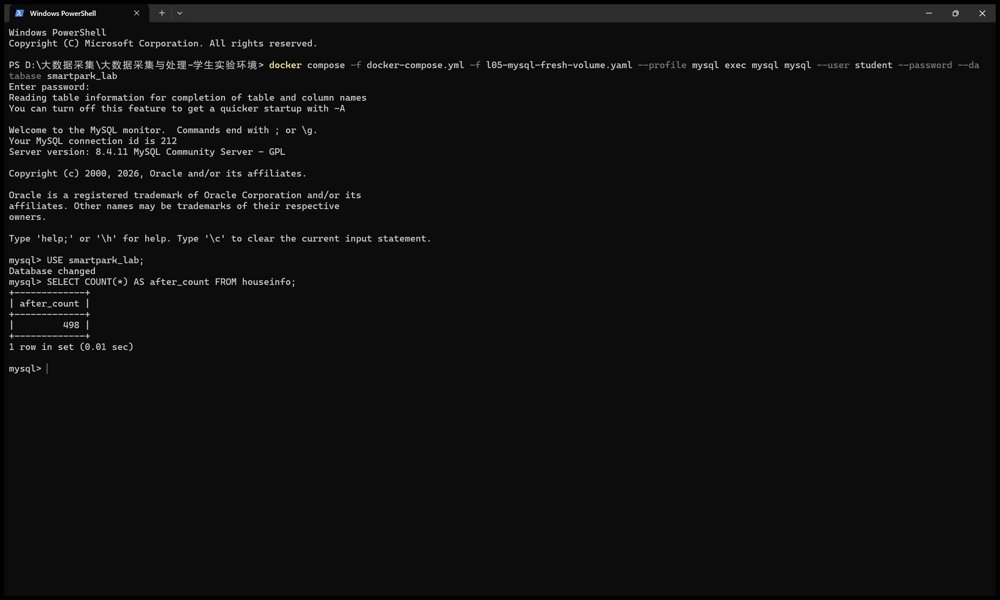
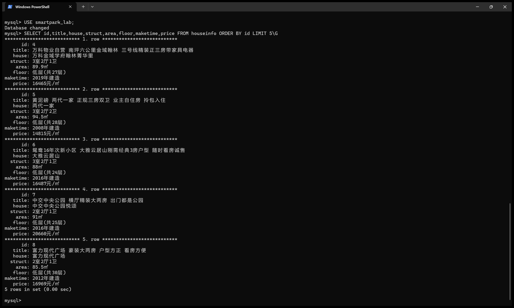
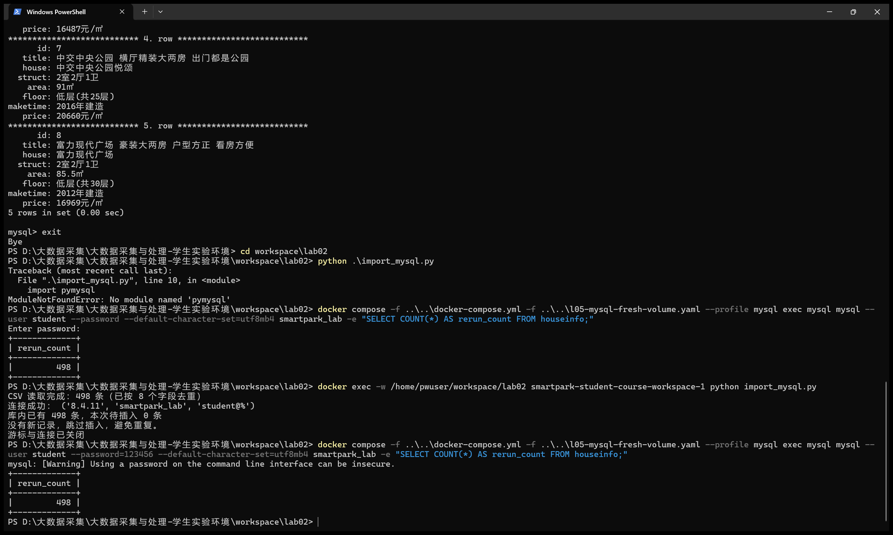
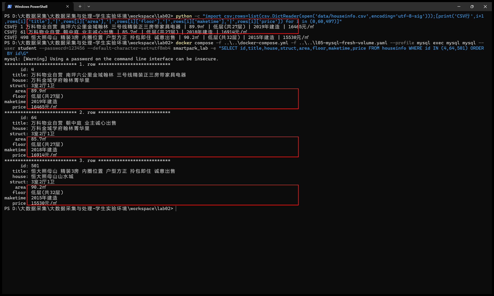

# 实验二报告：房源采集与 MySQL 存储

- 班级：
- 姓名：
- 学号：112404260107
- 实验日期：2026-10-28
- GitHub 仓库链接：
- 源码文件名：lab02/anjuke.ipynb（第一、二阶段采集）、lab02/import_mysql.py（第三阶段入库）
- 数据库与表：`smartpark_lab.houseinfo`
- 数据来源：在线教学站 http://www.bspider.top/anjuke/（在线采集成功）
- 访问时间及结果（若失败，填写状态码、页面标题或报错）：2026-10-28 08:30 左右，`requests.get` 返回状态码 200，页面标题"重庆二手房房产网，重庆二手房出售，重庆买房购房交易信息 - 58安居客"，确认是房源列表页，不是访问验证页。
- 快照文件来源与文件名（在线实验可写"不适用"）：不适用（在线采集完成）

> 填写要求：截图放在 `images/` 中，在对应位置插入图片。代码截图要显示文件名、行号或单元位置，用红框标出关键代码，每项写2—3句话解释。只截最终结果或只贴 AI 生成的文字，不能代替实验过程。未完成的项目写明原因，不填写预期结果，不展示个人账号密码。

## 第一阶段：MySQL Docker 更新与启动

- 本次是否需要更新：已按 L05 增量更新包说明更新。5 个配套文件（`l05-mysql-fresh-volume.yaml`、`start-mysql.bat`、`stop-mysql.bat`、`mysql-console.bat`、`l05-mysql.ps1`）已复制到原课程目录；`mysql:8.4.11` 镜像 ID 核对为 `sha256:85b9bf2e29cf836ecb8c2a15a935d4ba0c606631dff1dd79531a11983c638f2a`，与更新包说明一致。
- 更新或启动遇到的问题：首次导入的镜像 ID 不符（本地重建镜像导致），按更新包 README 重新以 OCI 归档导入官方镜像后 ID 一致；随后 `start-mysql.bat` 启动成功，显示"[PASS] L05 MySQL healthy，账号连接检查通过。"。数据卷为独立教学卷 `smartpark-student_l05-mysql-data`，未动原课程卷。

### 启动环境与建表

依次使用 `start-course.bat`、`start-mysql.bat`、`mysql-console.bat` 启动课程环境、数据库和 MySQL 终端。

**截图：** MySQL 启动成功提示，以及终端中 `USE smartpark_lab`、`SHOW TABLES`、`DESCRIBE houseinfo` 的执行结果。可分图。

说明：当前使用哪个数据库？`id` 和8个房源字段分别保存什么？

答：当前使用 `smartpark_lab` 数据库（`SHOW DATABASES` 中可见，`USE smartpark_lab` 后 `Database changed`）。`SHOW TABLES` 显示只有 `houseinfo` 一张表。`id` 是 `INT AUTO_INCREMENT PRIMARY KEY`，由数据库自动生成的自增长主键，不参与采集。其余 8 列：`title` 标题、`house` 楼盘、`address` 地址、`struct` 户型、`area` 建筑面积、`floor` 楼层、`maketime` 建造年代、`price` 每平方米单价，均为 VARCHAR，保留面积、单价中的单位。

## 第二阶段：房源采集与 CSV 数据存储

### 1. 网页分析与房源解析

#### 选择器是怎样得到的

在 Chrome 中按 F12，使用 **Elements → Copy → Copy selector**。选一个字段，记录从完整路径到相对选择器的过程。

- 选择的字段：标题 h3（第一条房源"万科物业自营 南坪六公里金域翰林 三号线精装正三房带家具电器"）
- 复制的原始选择器：`#content > div.page > … > section.list > div:nth-child(1) > a > div.property-content > div.property-content-detail > div.property-content-title > h3`（从页面根节点出发，含多层 `:nth-child()`，页面结构一变就失效）
- 一条房源的父容器选择器：`div.property`（`tongji_tag="fcpc_ersflist_gzcount"` 的 div，向上检查确认它刚好同时包住标题、楼盘、地址、属性组和价格，第二条房源也是相同的 class）
- 最终使用的相对选择器：先 `soup.select("div.property")` 取整页房源，再在每条 `row` 内部用 `row.select_one("h3")` 等相对选择器取字段

**截图：** 框出该字段的 HTML 节点和房源父容器，展示选择器的匹配结果。

【在此插入截图】

说明：删掉了哪些层级？怎样确认父容器刚好包含一条房源？

答：删掉了从 `#content` 根节点到房源列表之间所有与位置相关的层级（`div:nth-child(3)`、`section:nth-child(2)` 等），只保留"房源容器 → 容器内字段"两级。确认方法：`len(rows)` 返回 60（等于页面上实际房源数），且 `rows[0]` 内部 `select("h3")` 只有 1 个、`select_one("p.property-price-average")` 能取到本条房源自己的价格，说明容器刚好包住一条房源，不会串到下一条。

#### 解析8个字段

**截图：** 自己编写的解析代码和首条房源的8个字段输出。代码中必须框出：

- `select()` 和 `select_one()`。
- 面积、单价的定位与取值。
- 建造年代的提取和缺失处理。

可分成几张局部截图。另附面积、单价对应的 HTML 节点或网页原文。

【在此插入截图】

说明：两个选择方法各用在哪里？怎样确认面积和单价没有取错？

答：`select("div.property")`、`select("p.property-content-info-text")`、`select("span")` 用于取"一组"节点（所有房源、属性组所有项、地址所有 span）；`select_one("h3")`、`select_one("p.property-price-average")` 等用于取容器内"唯一"的第一个节点。面积是属性组中含"㎡"的那一项（首条为 `89.9㎡`），单价取 `p.property-price-average`（首条为 `16465元/㎡`），并对照网页确认不是总价 `148万`（总价在 `p.property-price-total`，不采集）。解析前先把属性组 4 个 `
` 逐项打印确认顺序：户型、面积、朝向、楼层、年代，避免把"南北"当楼层。

### 2. 下一页采集

- 下一页 `href` 原值：`?page=2`（相对地址）
- 用 `urljoin()` 补全后的地址：`http://www.bspider.top/anjuke/?page=2`
- 实际停止原因（明确禁用的末页按钮 / 异常中止）：明确禁用的末页按钮——第 10 页的 `a.next` 的 class 只剩 `next`（没有 `next-active`），`href` 变为 `#`，据此判定到达末页，正常停止。

**截图：** 框出提取 `href`、补全地址、循环更新地址和停止条件的代码。附前两页的运行日志，以及最终停止提示。离线实验展示快照中的href、补全结果和文件读取记录，注明"离线回放"，不算在线翻页成功。

【在此插入截图】

说明：怎样进入下一页？怎样防止重复采集或无限循环？

答：每页解析完后用 `page_soup.select_one("a.next.next-active")` 找"下一页"按钮，`get("href")` 取地址，`urljoin(current_url, href)` 补全成完整 URL 后作为下一轮的请求地址；按钮找不到（末页被禁用）就停止。防重复/防死循环：用 `visited` 集合记录已访问地址，地址重复即停止；请求间隔 `time.sleep(1)`；设安全上限 `max_pages=30`，达到上限记为"中止"而不是"采集完成"；下一页地址若越出 `http://www.bspider.top/anjuke/` 也停止。

### 3. 保存 CSV

**截图：** CSV保存与回读代码、回读条数。框出编码、表头和数据写入部分。

【在此插入截图】

说明：8个字段的顺序是什么？按8个字段完全相同去重后，保存了多少条记录？

答：顺序固定为 `title → house → address → struct → area → floor → maketime → price`，与建表语句一致，写入前用 `assert len(rec) == 8` 保证每条恰好 8 项。文件用 `csv.writer`、编码 `utf-8-sig`、`newline=""` 保存。本次共翻 10 页、采集 600 条（去重前），其中 8 个字段完全相同的重复记录 102 条，按实验要求去重后实际保存 **498 条**数据行（不含表头）。教学站部分房源由不同经纪人重复发布，8 个字段完全一致但链接不同，按本实验"按8个字段完全相同去重"的口径被合并；总条数以实际采集为准。

## 第三阶段：MySQL 数据存储

本阶段读取第二阶段的 `data/houseinfo.csv`，不重新采集。入库程序为独立编写的 `lab02/import_mysql.py`。

### 1. 读取 CSV 并入库

**截图：** 框出读取CSV、按8个字段整理入库参数的代码。

说明（对应图中红框）：第一个红框是 `csv.DictReader` 读取文件并检查表头（`reader.fieldnames != FIELDS` 时直接报错）；第二个红框按 `title→house→address→struct→area→floor→maketime→price` 的固定顺序把每行整理成 8 项元组，保证与 INSERT 的 8 个参数一一对应；第三个红框在文件内部按"8 个字段完全相同"去重，只保留一条。

**截图：** 自己编写的入库代码。框出 `executemany()`、`commit()`、`rollback()`，以及关闭游标和连接的操作。另框出避免重复插入的代码。

说明：每条记录怎样对应8个参数？成功、失败时分别做什么？再次运行时怎样避免重复插入？

答：INSERT 语句写成 `INSERT INTO houseinfo (title, house, …, price) VALUES (%s, …, %s)`，8 个字段对应 8 个 `%s`；`executemany(INSERT_SQL, todo)` 的第二个参数是元组列表，每个元组恰好 8 个值、顺序与字段一致（第 49–52 行整理时已固定），值通过参数传入，不用字符串拼接。成功时：先试写 3 条并 `rollback()` 撤销（验证事务可控），再全量 `executemany()` 后 `conn.commit()` 提交；失败时进入 `except` 分支执行 `conn.rollback()`，撤销本次事务中未提交的修改。`finally` 中先 `cursor.close()` 再 `conn.close()`，成功失败都释放资源。避免重复插入：第 79–86 行先 `fetch_existing()` 把库内已有记录读成集合，`todo = [rec for rec in records if rec not in existing]` 只保留库里没有的记录，所以重跑同一批数据时待插入为 0 条，不重复入库（不用清空表）。

### 2. 核对结果

#### 查询条数和样本

**截图：** MySQL 终端中的入库前后 `SELECT COUNT(*)`、重跑后的条数，以及 `SELECT ... LIMIT 5` 的结果。

| 项目 | 实际结果 |
|---|---|
| 成功采集页数 | 10 |
| 采集记录数（去重前） | 600 |
| 完全相同的重复记录数 | 102 |
| CSV数据行数（不含表头） | 498 |
| 入库前条数 | 0 |
| 入库后条数 / 本次新增条数 | 498 / 498（executemany 影响行数 498，与 CSV 数据行数一致） |
| 关闭上次程序后，同批数据独立重跑的条数 / 新增条数 | 498 / 0（程序输出"库内已有 498 条，本次待插入 0 条，没有新记录，跳过插入"） |
| 是否采集完整；未完成的原因 | 采集完整（第10页"下一页"按钮已禁用，正常停止） |

说明：首次入库后的条数应等于去重后的CSV数据行数，8个字段的内容也应一致。若不一致，说明原因。总条数以实际结果为准。

答：一致。入库后 `after_count = 498`，等于去重后的 CSV 数据行数 498；重跑后仍为 498，新增 0 条。另外用程序按 `ORDER BY id` 逐条比对，数据库 498 条记录的 8 个字段与 CSV 完全相同、顺序一致，无差异。一点说明：`id` 从 4 开始到 501，是因为入库前先用 3 条真实记录试写并 `rollback()`，InnoDB 的自增计数器不随回滚退回，消耗了前 3 个编号；不影响数据内容。

#### 逐条核对

选取第一条、跨页一条和最后一条，比较网页、CSV与数据库中的8个字段。快照实验对照教师提供的网页文件。

**截图：** 三条样本的对照结果，框出面积、单价和年代。可分图。

- 样本1（页码或URL、记录位置）：第1页第1条（CSV 第1行，库中 id=4）"万科物业自营 南坪六公里金域翰林 三号线精装正三房带家具电器"，面积 89.9㎡、单价 16465元/㎡、2019年建造
- 样本2（页码或URL、记录位置）：第2页第1条（CSV 第61行，库中 id=64）"万科物业自营 朝中庭 业主诚心出售"，面积 85.7㎡、单价 16914元/㎡、2018年建造
- 样本3（页码或URL、记录位置）：第10页最后一条（CSV 第498行，库中 id=501）"恒大照母山 精装3房 内圈位置 户型方正 拎包即住 诚意出售"，面积 90.2㎡、单价 15530元/㎡、2015年建造

核对结论及差异：三条样本在网页、CSV 和数据库中的 8 个字段（含红框标出的面积、楼层、年代、单价）逐字段一致，无差异。数据库自动生成的 `id`（4/64/501）与 CSV 行号相差 3，原因见上（试写回滚消耗了 3 个自增编号），不影响字段内容。

## 问题与解决

- 遇到的问题、处理方法及结果：
  1. 首次导入的 `mysql:8.4.11` 镜像 ID 与更新包说明不一致，`start-mysql.bat` 拒绝启动；按更新包 README 用附带的镜像归档重新导入，核对 ID 一致后启动成功。
  2. 教学站分页内容会动态变化（同一房源可能在多页重复出现），去重前 600 条中有 102 条 8 字段完全相同的重复记录；按实验要求去重后保存 498 条。
  3. 容器内没有 `clear` 命令，MySQL 终端里 `system clear` 报 `clear: command not found`；改用重新登录后截图，不影响数据。
  4. 第三阶段在 Windows 本机直接运行 `import_mysql.py` 报 `ModuleNotFoundError: No module named 'pymysql'`；pymysql 装在课程容器里，改用 `docker exec -w /home/pwuser/workspace/lab02 … python import_mysql.py` 在 JupyterLab 容器内运行，正常。
  5. MySQL 终端里查询中文显示为"？？？"，是客户端字符集问题；连接时加 `--default-character-set=utf8mb4` 后中文正常显示。
- 尚未解决的问题、未完成的步骤（没有可写"无"）：无，三个阶段均已完成。

## 思考题

1. 本次怎样实现下一页采集？结合自己的代码说明。

   答：每页解析完后用 `page_soup.select_one("a.next.next-active")` 找"下一页"按钮——可点击的下一页按钮同时有 `next` 和 `next-active` 两个 class，末页按钮只剩 `next`。找到后用 `next_a.get("href")` 取地址（注意 `get_text()` 取到的是"下一页"三个字，`get("href")` 才是链接），本站返回的是相对地址 `?page=2`，再用 `urljoin(current_url, href)` 补全成 `http://www.bspider.top/anjuke/?page=2`，作为下一轮请求地址循环下去。停止条件：按钮找不到（末页被禁用）、地址重复、地址越出教学站、或达到 `max_pages=30` 安全上限（此时记为"中止"而不是"采集完成"）。本次在第 10 页因按钮禁用正常停止。

2. 旧代码把 out_list 定义在全局。你把结果列表放在哪里？为什么？

   答：放在函数内部：解析函数 `parse_record(row)` 每次只返回一条记录（一个 8 项列表），汇总列表 `records` 定义在采集函数 `collect()` 内部、由 `collect()` 返回；入库脚本里 `read_csv()` 同样在函数内建 `records` 并返回。这样列表的生命周期限制在函数里，多次调用不会互相残留上一次的数据（全局列表重复运行会越积越多），也避免不同函数意外改到同一个全局变量；需要用时通过返回值拿到，来源清楚。

3. 你怎样获取建造年代？节点缺失或顺序改变时，怎样处理？

   答：不按固定下标取属性组里的第几项，而是遍历 `div.property-content-info` 下的所有 `p.property-content-info-text`，按内容特征判断：含"㎡"的是面积、含"层"的是楼层、含"年"且含"建造"的是建造年代，其余是朝向（不采集）。这样属性组里各项顺序变化也不影响取值；如果某条房源没有年代节点，循环里匹配不到，`maketime` 保持初始的空字符串，该条记录照常保存，不会让整条记录失败。解析前还把第一条的属性组逐项打印出来核对了顺序。

## 提交检查

- [x] 实验一原仓库的 `lab02/` 中已有源码、CSV、报告和真实截图。
- [ ] 截图清楚，关键代码已框出，每项附有个人解释。
- [ ] GitHub上能打开文件和图片，未上传个人账号密码、`.env`或教师答案。
- [ ] 未完成项已如实说明；学习通只交原仓库链接。

如使用 AI，简述它帮助了什么，以及自己修改、运行和核对了什么：

答：AI 帮助生成了 Notebook 和入库程序的代码框架、解释了 pymysql 各函数的用法，并协助排查镜像 ID 不符、pymysql 缺失、字符集乱码等问题。代码经本人核对修改后在课程容器中实际运行：采集 10 页 600 条、去重后保存 498 条 CSV，入库 498 条并重跑验证不重复；报告中所有截图均为本人在终端、VS Code 中实际操作的截图，样本已逐字段核对。
